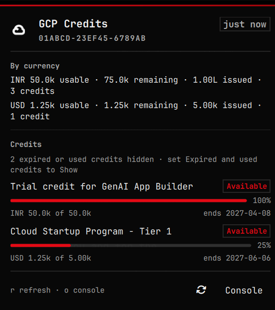

# GCP Credits

Shows Google Cloud credit balances in the Omarchy bar. It answers one question the `gcloud` CLI cannot answer, since the Cloud Billing API has no credits method, and the billing console gets its numbers from a private browser API.

## What it shows

The bar shows the Google Cloud mark alone, like the other icon widgets. Hover it for the amounts, one line per currency, plus the account and the age of the reading. A failed fetch replaces the mark with a warning glyph, and the tooltip carries the error and its hint, each shortened to one line that fits the screen; the panel carries them in full.


While no snapshot has been read yet the mark stays, dimmed, and the tooltip says so: that is a wait, not a failure. Clicking the mark opens a panel with every credit: name, remaining amount out of the original, percent remaining, end date and state, the same values and statuses as the console credits page. Middle click refreshes, right click opens the console.



A snapshot larger than the panel keeps (200 credits, 12 currencies) is shown as its first slice with a count of the rest, and credits the `expiredCredits` setting hides are counted too, so a short list never looks like the whole account.

## Setup

The helper reuses your own browser session, because that session is the only thing that can read the credits. It clones your Chromium profile into `~/.cache/gcp-credits/profile` and drives that clone headless, so your real profile gains no locks and no windows.

```bash
omarchy plugin add https://github.com/adi-IL/omarchy-gcp-credits
cd ~/.config/omarchy/plugins/adix.gcp-credits
node bin/gcp-credits.mjs setup     # clone the Chromium profile into ~/.cache/gcp-credits/
node bin/gcp-credits.mjs fetch     # prints the snapshot, writes ~/.cache/gcp-credits/credits.json
```

A cold fetch takes about four seconds. If `fetch` reports `auth_required`, sign the clone in once:

```bash
node bin/gcp-credits.mjs login     # opens the clone with a visible window
```

Then enable the widget, which puts it first in the right section:

```bash
omarchy plugin enable adix.gcp-credits --section right --index 0
```

`omarchy bar move adix.gcp-credits [placement]` moves it afterwards, with the same placement options.

## Commands

| Command | Purpose |
| --- | --- |
| `fetch [--account ID]` | Refresh the snapshot, print it as JSON on stdout, and write it to the cache. Exit 0 on success, 1 on failure. |
| `doctor` | Report the Chromium path, profile state, cache, lock state, running browser, billing account and version. |
| `setup [--profile DIR]` | Delete and re-clone the isolated profile, clearing stale lock files. Keeps the cached billing account. |
| `login` | Open the clone with a visible window so you can sign in once. |

A successful `fetch` also prints a one-line summary on stderr; the JSON on stdout is what the widget parses, so it is always printed. `--account` and the `GCP_CREDITS_ACCOUNT` environment variable override the cached billing account, and `GCP_CREDITS_CHROMIUM` overrides the browser path.

Failure codes, all reported as `code` in the JSON: `setup_required`, `auth_required`, `browser_running`, `browser_failed`, `no_billing_account`, `bad_account`, `no_chromium`, `no_source_profile`, `copy_failed`, `http_error`, `network_error`, `query_rejected`, `empty_response`, `busy`, `unexpected`.

## Settings

Set them per widget, for example `omarchy bar set adix.gcp-credits format exact`. The plugin settings panel offers the same keys.

| Key | Default | Meaning |
| --- | --- | --- |
| `intervalSeconds` | `900` | How often the helper runs. Minimum 300. |
| `format` | `compact` | `compact` shortens large amounts, `exact` prints full numbers. |
| `expiredCredits` | `Hide` | Whether the panel lists credits that are expired or fully spent. |
| `billingAccount` | empty | Billing account id. Empty means the open account from `gcloud billing accounts list`. |

## How it works

The helper reads the billing account from `gcloud billing accounts list`, launches a hidden Chromium against the cloned profile over the debug pipe, runs the console's own `ListCreditsDetail` query against `cloudconsole-pa.clients6.google.com` with that profile's session cookies, and writes one JSON snapshot to `~/.cache/gcp-credits/credits.json`. The widget reads that file at start and after every fetch, so the bar shows the last known state immediately.

A Chromium profile usually holds more than one Google account, and the private API answers for the account its `authuser` index names. A billing account only answers for the account that owns it and refuses every other index with a permission error, so the helper tries the indices in order and keeps the first one that answers with data; the index it used is recorded in the snapshot as `authUser`. That is what lets a re-cloned profile work when the useful account is not the first one.

Credits arrive in more than one currency, so the snapshot groups totals by currency instead of inventing a single sum. `usable` counts only credits that still have funds and a live window.

## Security

The clone holds session cookies for your Google account, so everything under `~/.cache/gcp-credits/` is created owner-only: the directory `0700`, the profile copy, the cache, the config and the browser log `0600`. `setup` forces those modes with `rsync --chmod=D700,F600`, so a loosened source profile cannot leak a readable cookie jar.

The helper talks to Chromium over a debug **pipe** (`--remote-debugging-pipe`, fd 3 and fd 4), not a debugging port, so no listening socket exists while a fetch runs and no other local process can drive that browser. The sign-in window opened by `login` is launched without any debug channel at all. A fetch stops its browser on every path, including a `Ctrl+C` or a `kill`: the helper handles `SIGINT` and `SIGTERM`, and a headless browser left behind by a `SIGKILL` is reaped by the next fetch instead of blocking it. A window with the clone open is never taken over: the fetch reports `browser_running` and waits for you to close it.

The clone is bound to its own path and keychain entry, so a copy of it elsewhere is signed out even though the cookie files are identical. Keep it where `setup` put it, and use `login` when it needs a fresh sign-in.

Snapshots are written to a temporary file and renamed over the old one, so the widget never reads a half-written file. Losing the fetch race (`busy`) leaves the last good snapshot in place rather than replacing it with an error.

If you stop using the plugin, remove the widget (`omarchy plugin remove adix.gcp-credits`), sign the clone out (`chromium --user-data-dir=~/.cache/gcp-credits/profile`), and delete `~/.cache/gcp-credits/`.

## Credits

The Google Cloud mark in the bar and in the panel comes from [Simple Icons](https://simpleicons.org) (`googlecloud.svg`, released under CC0 1.0), shipped as `assets/google-cloud.svg` and tinted to the active theme. The Google Cloud name and logo are trademarks of Google LLC, used here only to label your own Google Cloud data.

The plugin itself is MIT licensed, as its manifest declares; see `LICENSE`.

## Tests

`test/model-tests.mjs` runs fast unit checks against `Model.js` (coercion, snapshot parsing, currency formatting, bar labels, and panel row helpers) with no browser or network access.

`test/helper-tests.sh` runs the helper's own checks against a throwaway `HOME` with a copy of the profile clone, so the real cache is never touched: the lock and reaping paths, the debug pipe (and the absence of a debug port), signal cleanup, torn reads, a live-window refusal, the failure codes for bad accounts and a missing Chromium, `setup` keeping the account id, and `doctor`. One check does a real fetch through the copied profile, so it needs an intact signed-in clone and a Chromium.

```bash
cd ~/.config/omarchy/plugins/adix.gcp-credits
node test/model-tests.mjs              # pure display model unit checks
./test/helper-tests.sh                 # helper integration checks, about eight minutes
./test/helper-tests.sh path/to/gcp-credits.mjs   # or a specific helper build
```

## Editing the plugin

Saving a file under the plugin directory reloads the widget, but the shell keeps the copy of `Model.js` it already loaded and the panel it already created, so edits to `Model.js` or `Panel.qml` show up only after a restart:

```bash
omarchy restart shell
```

`BarWidget.qml` and the components it loads directly (`GoogleCloudMark.qml`) do take effect on the next save, and the helper is a separate process, so changes to `bin/gcp-credits.mjs` take effect on the next fetch.

## Troubleshooting

| Symptom | Fix |
| --- | --- |
| `setup_required` | Run `node bin/gcp-credits.mjs setup`. |
| `auth_required` | Run `node bin/gcp-credits.mjs login` and sign in. |
| `browser_running` | A window has the clone open. Close it; the next refresh runs on its own. |
| `no_billing_account` | Pass `--account <id>` or set `GCP_CREDITS_ACCOUNT`. |
| `bad_account` | The id is not a billing account id. Take it from `gcloud billing accounts list`. |
| `busy` | Another fetch holds the lock; the snapshot in the cache is left untouched and the next interval retries. |
| `network_error`, `http_error` | The request to Google failed. Check the network; `login` if the session expired. |
| `query_rejected` | Google changed the console query, so the stored signature is stale, or no account in the clone can read that billing account. Capture the new `ListCreditsDetail` call from the credits page in DevTools and update `QUERY_SIGNATURE` in `bin/gcp-credits.mjs`. |
| `no_chromium` | Point `GCP_CREDITS_CHROMIUM` at an executable Chromium. |
| `no_source_profile` | The profile to clone has no cookies. Pass `--profile <dir>` to `setup`, or sign in to Chromium once. |
| `copy_failed` | The profile copy failed. `doctor` prints the source path; check free space and permissions. |
| `browser_failed` | Run `doctor`; a headless browser left behind is reaped by the next fetch, and a stale `SingletonLock` is cleared by `setup`. |
